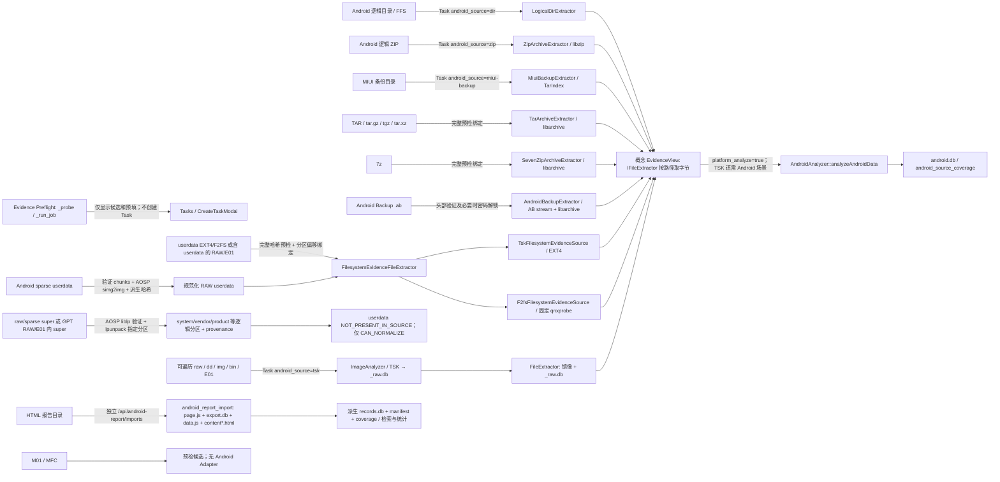

# Android / 第三方取证数据输入能力审计

范围：`feature/android-forensics-report-structure` 当前代码，2026-09-26。第一阶段是只读审计；第三阶段 TAR/7z/AB、第四阶段 Android userdata EXT4/F2FS 与 RAW/E01、第五阶段 sparse/super 已完成相应合成来源的生产 Task 验收。这里只判断**已接通的生产调用链**；未拿到的美亚原始样本不作兼容性承诺。

6B 只在**已存在的** AndroidAnalyzer `android.db` 上增加“单条记录→冻结结果集→Investigation/R2”的派生调查链，不新增任何输入 Adapter，因此本矩阵各格式的 `DETECT/CAN_*` 等级不因 6B 提升。详见 [`android-investigation-6b.md`](android-investigation-6b.md)；真实样本仍为 `REAL_SAMPLE_REQUIRED`。

## 判定口径

四级状态按能力递进，但不是“数据已取证完整”的证明：

- `DETECT_ONLY`：只能识别候选类型、文件头/后缀/目录标记；单个外层文件的大小和 SHA-256 不算内部枚举。
- `CAN_ENUMERATE`：能列出来源内部文件/成员/报告页（可有明确上限），尚不能把目标 Android 文件按路径交给解析器。
- `CAN_NORMALIZE`：有实际生产 Adapter，把来源中的目标文件映射成 Android 相对路径并提供内容，或把第三方报告表格行规范化为**单独标注的派生记录**。两者不可混为原始证据。
- `CAN_ANALYZE`：生产 Task 能调用 `AndroidAnalyzer::analyzeAndroidData()` 并写入 `android.db`；只表明**具备该链路**，不保证所有文件、数据库、加密内容均被解析。报告包的检索/分类不计入这一级。

`UNRECOGNIZED` 表示连专用类型预检都没有，低于 `DETECT_ONLY`；`SAMPLE_REQUIRED` 是未知格式的核验前提，不是第五级能力。矩阵中的“最高能力”是**在所列条件满足时**的生产上限；预检列独立于 Task。这里的 `FFS` 按“已导出的 full-file-system 目录树”理解；仓库没有名为 FFS 的专有文件格式识别器。如果项目方所称 FFS 指具体容器，须另取样本确认。

## 输入支持矩阵

| 输入 | Evidence Preflight 真实识别/枚举 | 预检最高 | 生产 Adapter / 最高能力 | 进入 `AndroidAnalyzer → android.db`？ | 限制与证据 |
| --- | --- | --- | --- | --- | --- |
| directory / FFS 目录 | 有 `data/data`、`data/user/0` 或 `system/build.prop` 才标 `android_logical_tree` / `dir`；否则 `unknown_directory`。目录清单可限额枚举。 | `CAN_ENUMERATE` | `LogicalDirExtractor` 将相对路径映射到目录文件；符合 Android 逻辑树时 `CAN_ANALYZE`。任意目录仅 `CAN_ENUMERATE`。 | **有条件是**：Task 选 `dir`、初始化成功且 `platform_analyze=true`。 | 预检快速模式最多 20,000 文件或 15 秒；完整清单最多 1,000,000 文件。`dir` 初始化只验证是目录，非格式认证；目录根布局不同可能仅得空/部分覆盖。 |
| ZIP | PK magic 标 `zip_container`；≤16 MiB、≤20,000 项才检查中央目录。安全且含 `data/data/` 或 `data/user/0/` 时升级为 `android_logical_zip` / `zip`。 | `DETECT_ONLY`；限额内 `CAN_ENUMERATE` | 本构建启用 `HAVE_LIBZIP`，`ZipArchiveExtractor` 按 Android 路径读取成员；符合布局时 `CAN_ANALYZE`。一般 ZIP 仅 `DETECT_ONLY`。 | **有条件是**：选择 `zip`、成员可读、`platform_analyze=true`。 | 大 ZIP 预检**不**展开成员，但手动选择 `zip` 仍可走 libzip；预检的危险路径/符号链接提示不是 Task API 的强制准入校验。不是任意 ZIP 内嵌镜像解析。 |
| TAR / tar.gz / tgz / tar.xz | `ustar` 或 gzip/xz 特征加相应后缀标 `tar_container`；后台限额枚举成员、检查危险路径并确认 Android root。 | 安全枚举 `CAN_ENUMERATE`；可信根 `CAN_NORMALIZE` | `TarArchiveExtractor` 经 libarchive 按需读取成员，复用 `AndroidPathMapper` 与 AndroidAnalyzer；满足来源/哈希条件时 `CAN_ANALYZE`。 | **有条件是**；隔离 HTTP Task 合成工件测试已实际写入 `android.db`。 | GNU/PAX 路径已测；超预检上限、恶意成员、冲突根路径不得一键分析。MIUI 内部 `TarIndex` 与通用 TAR 仍是不同适配器。 |
| 7z | 7z magic 标 `seven_zip_container`；用 libarchive 限额枚举，检测 Android root/锁定状态。 | 可枚举时 `CAN_ENUMERATE`；可信根 `CAN_NORMALIZE` | `SevenZipArchiveExtractor` 按需读取；未加密合成 7z 的 HTTP Task 已达到 `CAN_ANALYZE`。 | **有条件是**；Task 结果为 AndroidAnalyzer 的 `android.db`。 | 加密 7z 无密码 `LOCKED_ARCHIVE`；当前 libarchive 不支持的加密方法 `UNSUPPORTED_ARCHIVE_VARIANT`，不得承诺所有密码归档可读。 |
| Android `.ab` | 严格 `ANDROID BACKUP\n` 头部与版本/压缩/加密字段，分别标 `android_backup`、`android_backup_encrypted`、`android_backup_unsupported`；不是按后缀猜测。 | 明确头部 `DETECT_ONLY`；无密码或正确密码后可限额枚举/规范化 | `AndroidBackupExtractor` 流式解码 AB 后由 libarchive 读取内部 TAR，再用 `AndroidPathMapper`；正常/正确密码合成 AB 已达到 `CAN_ANALYZE`。 | **有条件是**；HTTP Task 合成工件和错误密码测试均已验收。 | 缺密码/错密码 `LOCKED_BACKUP`，未知加密/旧 v1 KDF `UNSUPPORTED_BACKUP_VARIANT`，截断 `MALFORMED_BACKUP`。独立 `.ab` 与 MIUI `.bak` 不是同一模式。 |
| OPPO ThunderForensic 提取（雷电手机快取 tar / 工程目录） | 目录含 `filesystem/1/tar/*.tar` 或 tar 文件本身，扫描成员名见到 `ThunderForensic.json` + `PhoneData/` 才标 `oppo_thunderforensic_backup` / `oppo-backup`。 | 扫描命中 `CAN_ENUMERATE` | `OppoBackupExtractor` 以 libarchive 索引容器成员（容忍老式 base-64 数值头、无尾部零块），`analyzeOppoBackup` 把 PhoneData JSON 工件写入 `mobile_backup_manifest`/`mobile_artifacts` 及 installed_apps/wifi/contacts/call_logs/sms/device_identifiers；合成 tar 与真实 OPPO R17 tar 的 CLI 与隔离 HTTP Task 均达 `CAN_ANALYZE`。 | **有条件是**：Task 选 `oppo-backup`、`dir` 或有效来源被自动提升、初始化成功。 | 联系人/短信等成员在本样本为空数组或提取器错误串时按空/`parse_failed`（含 `extractor_error` 原因）记录；LogData 与 sdcard 载荷仅清单不逐行解析；`Delete` 字段语义未定，只随 record_json 透传。 |
| MIUI backup 目录 | `descript.xml` + 任意 `*.bak` 标 `miui_backup` / `miui-backup`，并枚举目录。 | `CAN_ENUMERATE` | `MiuiBackupExtractor` 解析 manifest、校验引用的 `.bak`、索引包内成员；满足格式时 `CAN_ANALYZE`。 | **有条件是**：Task 选 `miui-backup` 或有效目录被自动提升、初始化成功且 `platform_analyze=true`。 | 预检条件弱于 Adapter：仅有文件名不代表可解析；加密/损坏包可记录为失败或锁定。 |
| 单分区 userdata EXT4/F2FS（`.img/.dd/.raw/.bin`，或无后缀且 offset 0 有文件系统 magic） | magic 只给候选；完整预检再只读枚举、确认 Android 路径标记、来源哈希与加密状态。 | 可证实时 `CAN_NORMALIZE`，仅 magic/后缀时 `DETECT_ONLY` | `filesystem-image`：EXT4 用 `TskFilesystemEvidenceSource`，F2FS 用固定 qnxprobe 的 `F2fsFilesystemEvidenceSource`，经 `IFileExtractor` 到 AndroidAnalyzer；合成 `CAN_ANALYZE`。 | **有条件是**：单分区 EXT4/F2FS 的 CLI 与隔离 HTTP Task 均写入 `android.db`；SMS2、联系人1、应用1、Wi‑Fi1。 | 加密文件不解密；锁定态 `COMPLETED_WITH_LOCKED_USERDATA`。未知厂商 F2FS 特性、压缩文件、超上限不承诺。 |
| 完整 RAW/DD/IMG/BIN 中的 userdata | 后缀仅候选；完整预检枚举 GPT/MBR 分区并结合文件系统与 Android 路径标记，不只依赖分区标签。 | 确认并完整哈希时 `CAN_NORMALIZE`，否则 `DETECT_ONLY` | 从绑定偏移的 EXT4/F2FS userdata 按需读取；合成 RAW+EXT4 与 RAW+F2FS 达到 `CAN_ANALYZE`。 | **有条件是**：隔离 HTTP Task 两种合成 RAW 均得到 SMS2、联系人1、应用1、Wi‑Fi1。 | `.bin` 可为任意内容；sparse/super 不在此列。多 TB 未实测。 |
| E01（单段 EWF）中 userdata EXT4/F2FS | EWF header/后缀仅候选；固定 qnxprobe/ewfprobe 与 TSK 验证逻辑分区、Android 标记及完整来源哈希。 | 确认并完整哈希时 `CAN_NORMALIZE`，否则 `DETECT_ONLY` | TSK 打开 EWF 容器/EXT4；F2FS 通过 ewfprobe 逻辑块视图按需读取。合成 E01+EXT4 与 E01+F2FS 达到 `CAN_ANALYZE`。 | **有条件是**：隔离 HTTP Task 两种合成 E01 均得到 SMS2、联系人1、应用1、Wi‑Fi1。 | 多段 EWF 集合不提供一键准入（首段哈希不足）；E02 单独并非已验证完整容器。无真实手机样本。 |
| Android sparse userdata（EXT4/F2FS） | magic 仅 `DETECT_ONLY`；header 合法 `CAN_ENUMERATE`；全 chunk/CRC 校验 `CAN_NORMALIZE_READY`；完整哈希预检实际安全转换并复探测后才给一键计划。 | 已验证 preview `CAN_NORMALIZE`；否则按阶段降级 | Task 在私有 workdir 调 AOSP `simg2img`，对派生 RAW 验哈希并复用第四阶段 `IFilesystemEvidenceSource → AndroidAnalyzer`。合成 EXT4/F2FS 均达 `CAN_ANALYZE`。 | **有条件是**：隔离 HTTP Task 的 raw/sparse 工件、WAL、coverage 与 6 条 provenance 完全等价，均 SMS2/联系人1/应用1/Wi‑Fi1。 | 不接受仅 magic、结构损坏、磁盘空间不足、未知文件系统或超展开上限；真实设备未验证。 |
| raw super | 不凭名称；LP geometry magic 后经固定 AOSP liblp 检查 metadata/checksum/extent；列出版本、槽、设备、分组和分区。 | 全哈希与 LP metadata 有效时 `CAN_NORMALIZE_READY` | Task 用 AOSP `lpunpack` 只导出所需 `system/system_ext/product/vendor/odm`，逐项重探 FS、验哈希；合成 raw super 达 `CAN_NORMALIZE`。 | **否（该构型）**：super Task 明确 `userdata=NOT_PRESENT_IN_SOURCE`，不运行用户工件解析。 | slot 显式选择，活动槽未知；EROFS 只识别为 `UNSUPPORTED_FILESYSTEM`。若具体逻辑分区以后独立接通可读 FS→AndroidAnalyzer，才能对该路径升级。 |
| sparse super | 先严格验证 sparse，AOSP `simg2img` 得 raw super，随后 liblp 校验 metadata；不能把 sparse 直接交给 `lpunpack`。 | 全哈希预检形成规范化计划 | Task `UNSPARSE → LP probe → 按需 lpunpack`；合成 raw/sparse super 的 3 个逻辑分区 SHA-256 一致，达 `CAN_NORMALIZE`。 | **否（该构型）**，userdata 不在来源中。 | 只支持单一完整 block-device；多设备缺件或 Virtual A/B snapshot 不重建。 |
| 完整 RAW/E01 中的 super 分区 | GPT/MBR 分区中验证 LP geometry，不只看 `super` 标签；E01 使用只读逻辑块视图。 | 完整哈希且 LP metadata 有效时 `CAN_NORMALIZE_READY` | Task 只派生目标 super 物理分区，不复制整个磁盘；合成 GPT RAW/E01 内 super 的逻辑分区哈希与独立 super 一致，达 `CAN_NORMALIZE`。 | **否（该构型）**；不推断 userdata 在 super 中。 | 多段 EWF 尚无完整分段哈希绑定，不一键准入。 |
| HTML report bundle | `index.html` + `report/*/export.db` 标 `derived_html_report` / `android_report`；预检只作目录枚举，**不**解析报告正文。 | `CAN_ENUMERATE`（目录文件） | 独立 Python 导入器静态读取 `page.js` 页映射、`export.db` 元数据、`data.js` 导航和 `content*.html` 表格行/无表格文本章节，写**派生** `records.db`、manifest、coverage；`CAN_NORMALIZE`（报告专用）。 | 否；Task 关联仅存 `task_ids`，不运行 AndroidAnalyzer。 | 仅接受明确的 JSON 赋值形状，JS 不执行。已用本地样例验证 22 页/7,404 条记录（7,366 表格行＋38 文本章节）；1 个缺失附件使状态为 `PARTIAL`，不是原始手机数据。详见 [`external-html-report-import.md`](external-html-report-import.md)。 |
| M01 | 仅 `.m01` 后缀命中 `vendor_container_unknown`，无 magic 校验。 | `DETECT_ONLY` | 无 Adapter；`DETECT_ONLY` + `SAMPLE_REQUIRED`。 | 否。 | 仓库未提供公开格式依据或真实样本，不推测结构。 |
| MFC | 仅 `.mfc` 后缀命中 `vendor_container_unknown`，无 magic 校验。 | `DETECT_ONLY` | 无 Adapter；`DETECT_ONLY` + `SAMPLE_REQUIRED`。 | 否。 | 同上；`.mf` / `.bcp` 也只有同一后缀候选逻辑。 |

注：SQLite 单文件另有预检 magic 和 `sqlite_inventory` **标签**，但不是已接通的单 DB→`android.db` Adapter。Task source 有 `filesystem-image` 与 `android-container`，均要求完整哈希预检；后者还绑定规范化 plan 与 metadata slot。旧式手工 `tsk` 不等于已验证来源。镜像最初的 `raw_image_candidate` / `ewf_candidate` 仍只是候选，不能凭扩展名升级。

## 真实调用图

下图 `EvidenceView` 是本审计对“可按 Android 相对路径读取来源字节”的**概念层**，仓库中不存在同名生产类；实际契约是 `IFileExtractor::extractFileByPath()`，报告分支也不实现该契约。箭头仅表示代码中可到达的链路，均受来源有效性和任务开关约束。

两条 Task 路径的实际门槛不同：`dir/zip/miui-backup/oppo-backup/tar/seven-zip/android-backup/filesystem-image/android-container` 走 `runLogicalAndroidAnalysis()`；新三种归档与镜像容器来源额外强制完整哈希预检、Adapter/类型匹配和 `platform_analyze=true`。`android-container` 还绑定规范化 plan SHA-256 与 metadata slot。super 任务只规范化系统分区、不调用 AndroidAnalyzer 的用户工件解析。旧 `tsk` 仍走 `_raw.db` 链并在 UI 标 `UNVERIFIED_SOURCE`。镜像打开成功、Task 100% 或 `android.db` 存在，都**不能**单独证明所有目标数据已解析；应查看来源覆盖和各表实际记录。

以上矩阵的 `android.db` 指 **HTTP Task 工作流**。CLI 的 [`AnalysisOrchestrator.cpp`](../src/AnalysisOrchestrator.cpp) 也将这些逻辑来源接到 AndroidAnalyzer，但仍用遗留命名 `<baseName>_files.db`。Task 分流与建库见 [`TaskManagerAnalysis.cpp`](../src/network/HTTPServer/TaskManagerAnalysis.cpp)、[`AndroidAnalyzerCore.cpp`](../src/analyzers/AndroidAnalyzer/AndroidAnalyzerCore.cpp)；概念 EvidenceView 的真实接口及新增适配器见 [`IFileExtractor.h`](../src/analyzers/AndroidAnalyzer/IFileExtractor.h)、[`ArchiveFileExtractor.cpp`](../src/analyzers/AndroidAnalyzer/ArchiveFileExtractor.cpp)、[`AndroidBackupStream.cpp`](../src/analyzers/AndroidAnalyzer/AndroidBackupStream.cpp)、[`AndroidPathMapper.cpp`](../src/analyzers/AndroidAnalyzer/AndroidPathMapper.cpp)。

## 关键边界核验

1. **新归档模式的预检已绑定 Task 准入。** 预检 `POST /api/evidence-intake/jobs` 仍不自动创建 Task；`tar/seven-zip/android-backup` 的按钮只在归档已安全枚举、找到可信 Android root、单文件完整 SHA-256 已验证时出现，并预填 job ID/来源哈希/类型。C++ `POST /api/tasks` 再核对 job、源路径、大小、哈希与 Adapter；分析前后重算来源哈希，变化报 `EVIDENCE_CHANGED_AFTER_PREFLIGHT`。旧 `dir/zip/miui-backup` 仍遵循原准入路径。见 [`evidence_preflight.py`](../python_service/httpserver/services/evidence_preflight.py)、[`EvidencePreflightPanel.jsx`](../web/src/components/tasks/EvidencePreflightPanel.jsx)、[`AndroidPreflightAdmission.cpp`](../src/network/HTTPServer/AndroidPreflightAdmission.cpp)。
2. **HTML 包确实被解析，但不是原始 Android 取证链。** 报告候选页检测只看 `index.html/report/*/export.db`。真正导入由 `/api/android-report/imports` 触发：静态读取 `page.js` 的页码/内容文件映射，读取 `archiveInfo` 与 `data.js` 导航，用 `HTMLParser` 从 `content*.html` 取表格行或保守的文本章节及来源定位，保存到独立 `android_report_imports/<id>/records.db`。manifest/coverage 给出 `COMPLETE/PARTIAL/FAILED`；来源回跳只提供转义文本。检索、分类和日期统计仅针对这些派生记录。已经在仓库外的本地样例完成导入与 API 集成验证：22 页、7,404 条记录（7,366 表格行＋38 文本章节）、缺失附件 1 条，状态 `PARTIAL`。见 [`android_report_import.py`](../python_service/httpserver/services/android_report_import.py)、[`android_report.py`](../python_service/httpserver/routes/android_report.py)、[`external-html-report-import.md`](external-html-report-import.md)。
3. **第四阶段补上可验证的文件系统镜像链。** EXT4 仍用 TSK inode 读取；F2FS 用固定提交、MIT 许可的 qnxprobe 1.34 经只读子进程桥接；E01 内 F2FS 由 ewfprobe 提供逻辑块视图。合成单分区、完整 RAW/E01、EXT4/F2FS 差分及隔离 HTTP Task 已实测通过，WAL 第二条短信确实进入结果。加密 inode fail closed，缺失/加密内容反映到 coverage；多段 EWF、真实 FBE 解锁、新 F2FS 特性不在承诺范围。见 [`android-filesystem-image-input.md`](android-filesystem-image-input.md) 和 [`FilesystemEvidenceSource.cpp`](../src/analyzers/AndroidAnalyzer/FilesystemEvidenceSource.cpp)。
4. **第五阶段补上 sparse/super 外层链。** sparse header/chunk/CRC 全结构校验后由固定 AOSP `simg2img` 转换；LP super 由固定 AOSP liblp 读取校验并经 `lpunpack` 按需导出，完整 RAW/E01 中只派生 super 物理分区。合成 HTTP Task 已验证 sparse userdata 工件等价、raw/sparse/full-disk super 逻辑分区哈希等价；super 不含 userdata 时 coverage 写 `NOT_PRESENT_IN_SOURCE`，不会宣称用户工件已分析。见 [`android-sparse-super-input.md`](android-sparse-super-input.md)、[`android_container_pipeline.py`](../python_service/httpserver/services/android_container_pipeline.py)。
5. **M01/MFC 仅按名字候选。** 既无格式校验/成员清单，也无可复核样本。必须先获取脱敏真实样本、产生工具/版本、导出说明、哈希与最小可对照文件，再讨论 Adapter；此处不猜测其内部结构。

## 剩余缺口优先级

| 优先级 | 缺口与现场影响 | 下一步所需证据/边界 |
| --- | --- | --- |
| P0 | 项目方若交付新的 LP metadata 版本、EROFS 用户工件、Virtual A/B snapshot、缺件多设备 super 或未知加密/厂商 F2FS 特性，合成 sparse/super 成功不保证现场兼容。 | 现场先取真实介质/脱敏同构样本、metadata 版本、分区表/文件系统类型及原工具对照清单；仅实测支持的构型升级能力。 |
| P0 | 若只交付 M01/MFC 专有容器，当前仅扩展名候选，无可实施的格式边界。 | `SAMPLE_REQUIRED`：索取公开格式说明或官方开放导出及真实样本；无依据不得估计可解析性。 |
| P1 | TAR/7z/AB 已有合成样本的端到端分析链，但未知现场包装层、过大归档和不同加密实现仍不能保证兼容。 | 现场先完成来源完整哈希与清单，逐项核对原工具导出的 Android 文件及应用库行数。 |
| P1 | 新归档 Task 强制预检绑定；旧 ZIP/目录仍未强制相同准入，且 Task 完成/建库不等于来源覆盖完整。 | 现场记录来源哈希、预检判定、解析覆盖/失败原因与原始文件抽样对照。 |
| P1 | HTML 报告虽已支持样例 `page.js` 静态映射和有标题的非表格文本章节，但未知 JS 版本、脚本动态生成内容或无可证明章节边界的页面仍不能保证兼容；超限页和截断行会标 `PARTIAL`。 | 用项目方后续不同版本样本与原工具清单对照；继续明确“派生报告”而非原始镜像。 |
| P2 | 文件系统镜像现有统一 `IFilesystemEvidenceSource`，但归档、目录和派生报告尚未共用跨格式 `EvidenceView`；`records.db` 与 `android.db` 继续分离。 | 未来若需融合，先定义来源类型、路径/偏移/页行、哈希和可回溯性，不改变既有证据语义。 |

第三阶段用确定性合成目录/ZIP/TAR/7z/AB 验证了 AndroidAnalyzer 的短信、联系人、应用和 Wi‑Fi 表计数，并在隔离 HTTP Task 中确认新三类来源写入 `android.db`、来源 provenance 与变更拒绝；详见 [`android-logical-container-input.md`](android-logical-container-input.md)。**没有**项目方未知格式的真实样本，也没有对多 TB 来源或所有加密变体做实测。因此“有条件 `CAN_ANALYZE`”不是对未知交付物的取证完整性保证。

第四阶段用合成单分区 EXT4/F2FS、完整 RAW/E01 内 EXT4/F2FS 六条链完成相同工件计数的差分；隔离 HTTP Task 六条均通过。LOCKED fixture 被标为完成但不完整，来源篡改返回 409。能力升级仅对应这些**已验证构型**，不代表真实设备、任意 EWF 分段或 TB 级检材已实测。

第五阶段在隔离 HTTP Task 验证 sparse EXT4/F2FS userdata 与 RAW 工件、WAL、coverage 和 provenance 完全等价；raw/sparse super 及 GPT RAW/E01 内 super 的三个逻辑分区 SHA-256 完全相同，slot 1 单独读取。能力升级只针对这些合成构型。EROFS 仍仅识别，Virtual A/B/FBE、多设备来源缺失与真实项目方镜像不在已验证范围。

## 第六阶段：交付闭环与现场准入修正

输入 Adapter 的最高能力**没有升级**。本轮增加独立固定预期的内容级多重集合差分：DIR/ZIP/TAR/7z/AB 与 EXT4/F2FS 单分区及 RAW/E01 的短信正文/号码/方向/时间、联系人、应用包名/版本和 Wi-Fi 字段一致；sparse EXT4/F2FS 的隔离 HTTP Task 与对应 raw 内容一致。原有 2/1/1/1 计数不再是唯一判据。super-only 仍无 userdata。locked 合成样本明确标为 `SYNTHETIC_ENCRYPTION_METADATA_ONLY`。真实美亚/手机镜像仍是 `REAL_SAMPLE_REQUIRED`，未知 schema、多账号与 TB 级不外推。

`android.db` 新增任务归属的只读四类工件查询/详情展示与独立离线结果包，HTML `records.db` 可同样打包且保留派生来源与 PARTIAL 警告。旧 Android 解析表没有逐条原库来源主键；UI 的单一文件路径只是候选，不能证明原始行或 WAL frame。`Investigation` 的 file/cluster evidence key、快照、grounding 与最终报告**尚未接通 Android 单条记录**，因此此阶段不能声称“短信→人工复核→报告引用→原库行”的完整业务闭环。详见 [`android-field-acceptance.md`](android-field-acceptance.md)。

当前敏感检材现场准入为 `BLOCKED`：8666/8090 匿名可访问列表、三端口全网监听、模型配置含公网端点；需先完成全入口认证和出站隔离。输入 `CAN_ANALYZE` 仅代表解析生产链存在，不代表可安全现场投产。

后续 6A 只增加现场认证与出站控制，**不升级本矩阵的任何输入格式等级**。合成隔离实例已达到限定范围的 `PASS_SECURITY_BASELINE`；未重启的生产实例仍为 `BLOCKED`。配置、例外、路由清单及切换门槛见 [`android-field-security-6a.md`](android-field-security-6a.md)。
