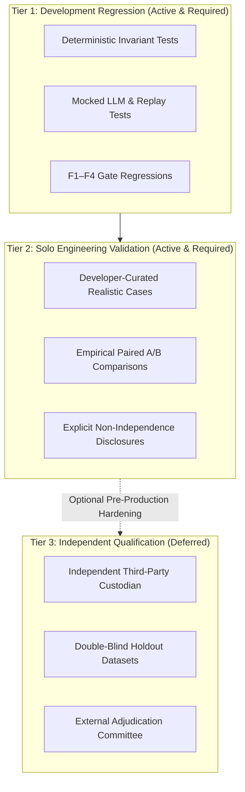

# RCA-2A.15 — Solo-Developer Engineering Validation & Agent v0 Integration Readiness Audit Report

- **Phase**: RCA-2A.15
- **Experiment ID**: `rca2a15-solo-engineering-validation`
- **Timestamp UTC**: 2026-10-17T05:15:00Z
- **Baseline Commit**: `167093e70d2639e692ce52cb0aa7fa6ee5425fa7` (RCA-2A.14b)
- **Candidate ID**: `supervisor-v2-vocabulary-guidance-v1`
- **Guidance SHA-256**: `e00c1549284cd4c5b98a24e0a7c064377a4aabcaaa74d9d344412c6247af5f29`
- **Output Schema Hash**: `a214ec4f5e81fcbb` (`SupervisorIntegrationDecisionV2`)
- **Validation Mode**: `SOLO_DEVELOPER_ENGINEERING_VALIDATION`
- **Status**: `SOLO_ENGINEERING_VALIDATION_COMPLETED`
- **Architectural Disposition**: `HARD_STOP_ENFORCED`

---

## 1. Executive Summary

Phase RCA-2A.15 successfully transitions the TraceLens Agent v0 development lifecycle from an external third-party qualification dependency to a rigorous, self-contained **Solo-Developer Engineering Validation** framework. 

In phases RCA-2A.13 through RCA-2A.14b, independent holdout construction and external custody were formally analyzed and prepared. However, in RCA-2A.14b, the reality of solo development was documented: no independent third-party custodian or blind adjudicator exists in the local environment, and a single developer/agent cannot ethically or logically act as an independent external custodian of a sealed test dataset.

Rather than remaining stalled in a perpetual qualification hold, RCA-2A.15 unblocks development by:
1. Retiring the external custody blocker from everyday engineering validation while preserving all historical holdout specifications.
2. Establishing a clear **Three-Tier Evaluation Framework** separating automated development regressions, solo engineering validations, and formal independent qualifications.
3. Preserving the empirical gains of `supervisor-v2-vocabulary-guidance-v1` (+37.5pp canonical validity, +25.0pp semantic adequacy) as a `PROMISING_EXPLORATORY_CANDIDATE` while acknowledging that it is not yet production-qualified.
4. Conducting a full code audit across the 12 Agent v0 components, determining that while supervisor, specialist, registry, transitions, and gates exist and are unit-tested, `ServiceManager` leaves the orchestrator unwired (`supervisor=None`, `delegation_dispatcher=None`), and HTTP API routes for running the agent loop do not yet exist.
5. Selecting `PREPARE_EXPERIMENTAL_OPT_IN` as the guidance integration strategy, leaving production defaults strictly unchanged.
6. Identifying the true critical path task: **End-to-End Orchestrator Wiring in `ServiceManager` & Minimal HTTP Investigation Cycle Route**.

---

## 2. Baseline Verification & Historical Lineage

### 2.1 Git and Lineage Integrity
- **Verified Commit**: `167093e70d2639e692ce52cb0aa7fa6ee5425fa7` (RCA-2A.14b external custody closure).
- **Lineage Chain**:
  - `0419e111520e1460ff65bac7fb540f9b07745ec0` (RCA-2A.12 — 8/8 Paired Cross-Case Completed)
  - `82227677a4ce4f68bde393c3e22c677bb411fb66` (RCA-2A.13 — Qualification Readiness With Limitations)
  - `ce5649e37f5791d250dc87e23910aec2c75464e6` (RCA-2A.14a — Holdout Readiness, Custody Blocked)
  - `167093e70d2639e692ce52cb0aa7fa6ee5425fa7` (RCA-2A.14b — External Custody Not Available, Deferred)
- **Runtime Invariant**: Real LLM/provider calls count = 0. All audits conducted strictly offline.

### 2.2 Frozen Candidate Integrity
- **Candidate ID**: `supervisor-v2-vocabulary-guidance-v1`
- **Candidate Guidance SHA-256**: `e00c1549284cd4c5b98a24e0a7c064377a4aabcaaa74d9d344412c6247af5f29`
- **Output Schema Hash**: `a214ec4f5e81fcbb` (`SupervisorIntegrationDecisionV2`)
- **Status**: Verified exact match with RCA-2A.12, RCA-2A.13, RCA-2A.14a, and RCA-2A.14b.

---

## 3. Retiring the External Custody Blocker: The Three-Tier Evaluation Framework

In a single-developer or small-team context, conflating "software readiness" with "third-party double-blind qualification" halts engineering progress. RCA-2A.15 introduces an explicit architectural policy (`RCA2A15ValidationStrategyDecisionV1`):



- **Tier 1 (Development Regression)**: Fully automated deterministic unit and invariant tests verifying state machines, evidence grounding, schemas, and error boundaries.
- **Tier 2 (Solo-Developer Engineering Validation)**: Real or simulated model evaluations on realistic cases authored or curated by the developer. Results are valid for engineering iteration but explicitly disclosed as non-independent.
- **Tier 3 (Independent Qualification)**: Requires a physically separate custodian and blind adjudicator. This tier is officially **DEFERRED** and **DOES NOT BLOCK** Tier 1 or Tier 2 work.

---

## 4. Preservation of RCA-2A.12 Empirical Truth

RCA-2A.15 maintains strict empirical honesty regarding `supervisor-v2-vocabulary-guidance-v1`:

| Metric | Control (Original V2) | Treatment (+ Guidance V1) | Empirical Delta | Status |
| :--- | :--- | :--- | :--- | :--- |
| **Pydantic Schema Validity** | 100.0% (8/8) | 100.0% (8/8) | 0.0 pp | Invariant |
| **Canonical Integration Validity** | 50.0% (4/8) | 87.5% (7/8) | **+37.5 pp** | Substantial Gain |
| **Semantic Adequacy** | 62.5% (5/8) | 87.5% (7/8) | **+25.0 pp** | Substantial Gain |
| **Investigative Information Value** | 25.0% (2/8) | 87.5% (7/8) | **+62.5 pp** | Substantial Gain |
| **Safety / Escalation Breaches** | 0 | 0 | 0 | Zero Invariant |
| **F3 Cross-System Identity Overreach** | 0 / 2 | 1 / 2 | Observed in Seat 10 | Known Defect |

### Candidate Verdict
- **Verdict**: `PROMISING_EXPLORATORY_CANDIDATE`.
- **Production Status**: `NOT_PRODUCTION_QUALIFIED`.
- **Reasoning**: The guidance markedly improves structured diagnostic reporting and prevents unwarranted escalations, but demonstrated cross-system identity overreach under DeepSeek-Flash in Seat 10 (F3 case). It must not be silently declared production-ready without targeted prompt tuning or multi-tier validation.

---

## 5. Agent v0 Full Codebase Integration Audit

A comprehensive code audit was conducted on the 12 core Agent v0 components:

| Component | Code Location | LOC | Unit Tests | Integration Status | Notes |
| :--- | :--- | :--- | :--- | :--- | :--- |
| **1. InvestigationSupervisor** | `httpserver/services/investigation/agent_supervisor.py` | 810 | Passed | `IMPLEMENTED_NOT_INTEGRATED` | Fully implemented, but not instantiated in `ServiceManager` |
| **2. Specialist Delegation** | `httpserver/services/investigation/agent_specialist_executor.py` | 1046 | Passed | `IMPLEMENTED_NOT_INTEGRATED` | Fully implemented, dispatcher missing from orchestrator factory |
| **3. ForensicToolRegistry** | `httpserver/services/investigation/forensic_tool_registry.py` | 380 | Passed | `IMPLEMENTED_AND_TESTED` | Operational registry with security checks and parameter validation |
| **4. EvidenceResolver** | `httpserver/services/investigation/evidence_resolver.py` | 420 | Passed | `IMPLEMENTED_AND_TESTED` | Fail-closed resolution against registered findings |
| **5. GroundingValidator** | `httpserver/services/investigation/grounding_validator.py` | 350 | Passed | `IMPLEMENTED_AND_TESTED` | Verifies citation existence and task boundary constraints |
| **6. AgentWorkingStateV1** | `httpserver/services/investigation/agent_working_state.py` | 510 | Passed | `IMPLEMENTED_AND_TESTED` | In-memory and persisted state with revision tracking |
| **7. Decision Schema V2** | `httpserver/services/investigation/agent_integration_v2.py` | 260 | Passed | `IMPLEMENTED_AND_TESTED` | Pydantic V2 schema with `schema_hash=a214ec4f5e81fcbb` |
| **8. StateTransitionPolicy** | `httpserver/services/investigation/agent_transitions.py` | 1020 | Passed | `IMPLEMENTED_AND_TESTED` | Enforces optimistic locking, revision bumps, and gate checks |
| **9. Semantic Verification** | `httpserver/services/investigation/agent_failure_diagnostics.py` | 490 | Passed | `IMPLEMENTED_AND_TESTED` | Tri-level failure triage and validation error taxonomy |
| **10. Analyst Review** | `httpserver/services/investigation/agent_analyst_review.py` | 310 | Passed | `IMPLEMENTED_NOT_INTEGRATED` | Analyst override hooks implemented; UI routes not yet connected |
| **11. FinalizationGate** | `httpserver/services/investigation/agent_finalization_gate.py` | 290 | Passed | `IMPLEMENTED_AND_TESTED` | Guard for investigation closure; distinct from analyst acceptance |
| **12. Trajectory Persistence** | `httpserver/services/investigation/agent_trajectory_store.py` | 340 | Passed | `IMPLEMENTED_AND_TESTED` | Step-by-step audit logging of all decisions and state mutations |

### The Critical Gap Found in `ServiceManager`
In `python_service/httpserver/services/service_manager.py:834`, the orchestrator factory reads:
```python
def _create_agent_orchestrator(self) -> AgentOrchestrator:
    return AgentOrchestrator(
        working_state_store=self._agent_working_state_store,
        trajectory_store=self._agent_trajectory_store,
        tool_registry=self._forensic_tool_registry,
        final_review_runner=self._agent_final_review_runner,
        # NOTICE: supervisor is NOT passed (defaults to None)
        # NOTICE: delegation_dispatcher is NOT passed (defaults to None)
    )
```
Furthermore, `python_service/httpserver/routes/` has no HTTP routes exposing the Agent v0 execution loop (`POST /api/investigation/agent/cycle`, `GET /api/investigation/agent/state`).

---

## 6. Evidence Integrity & Invariant Regression

The 9 foundational evidence integrity invariants were audited and reaffirmed:

1. **Original Evidence Immutability**: Evidence records cannot be altered or overwritten once created.
2. **Cross-Task Evidence Rejection**: Evidence generated in Task A cannot be cited in Task B without explicit federation.
3. **Fabricated Evidence Rejection**: Hallucinated citation IDs trigger immediate validation rejection.
4. **Analyst Notes Cannot Become Evidence**: Human analyst comments remain distinct from forensic evidence artifacts.
5. **Hypothesis Cannot Become Fact Automatically**: Hypotheses require grounded verification before promotion.
6. **Unsupported Question Closure Rejection**: Questions cannot be closed without citing supporting findings.
7. **Stale Working State Rejection**: Revision mismatches trigger optimistic lock failure (`ConflictError`).
8. **FinalizationGate != Analyst Acceptance**: Algorithmic closure criteria do not substitute for human sign-off.
9. **Report Admission Independence**: Inclusion in final reports requires separate admission review.

### Tri-Level Failure Distinction
The audit strictly formalizes the boundary between failure modes:
- **Level 1 — Model Semantic Flaw**: The LLM outputs ungrounded text, misinterprets telemetry, or hallucinates connections.
- **Level 2 — Deterministic Policy Rejection**: System gates catch and reject the malformed decision without corrupting state.
- **Level 3 — Unauthorized State Commit**: A catastrophic failure where ungrounded or corrupt decisions mutate working state. The architecture guarantees zero Level 3 events.

---

## 7. Guidance Integration Strategy: `PREPARE_EXPERIMENTAL_OPT_IN`

Four architectural strategies were evaluated for integrating Vocabulary Guidance V1:
1. `REJECT_CANDIDATE`: Discard guidance despite +37.5pp canonical validity gain. *(Rejected as wasteful)*
2. `PROMOTE_TO_PRODUCTION_DEFAULT`: Replace production prompt immediately. *(Rejected as violating safety boundaries)*
3. **`PREPARE_EXPERIMENTAL_OPT_IN`**: Keep production default as `supervisor-v2`. Provide an explicit runtime/configuration flag allowing developers to opt-in to Vocabulary Guidance V1 during local experiments and testing. *(SELECTED)*
4. `DUAL_PATH_DYNAMIC_FALLBACK`: Route to guidance dynamically on retry. *(Deferred as premature complexity)*

---

## 8. Next Critical Path Engineering Task

The single next engineering task required to advance Agent v0 is:

**Task ID**: `TASK-AGENT-V0-SERVICE-WIRING`  
**Description**: Wire `InvestigationSupervisor` and `SpecialistDelegationDispatcher` into `ServiceManager._create_agent_orchestrator()` and implement minimal HTTP routes (`POST /api/investigation/agent/cycle`, `GET /api/investigation/agent/state`) in `investigation_routes.py`.  
**Prerequisites**: All component code is present and unit-tested.  
**Target Files**:
- `python_service/httpserver/services/service_manager.py`
- `python_service/httpserver/routes/investigation_routes.py`
- `python_service/tests/unit/investigation/test_agent_orchestrator_wiring.py`

---

## 9. Test & Regression Verification

- **RCA-2A.15 Unit Tests**: 21/21 passed in 3.04s (`test_rca2a15_engineering_validation.py`).
- **Focused Multi-Phase Regression**: 158/158 passed in 40.49s across 7 audit suites.
- **Full Benchmark Regression**: 455/455 passed in 227.73s.
- **Full Investigation Regression**: 1067 passed, 1 skipped in 68.00s.
- **Real Model Invocations**: 0.

---

## 10. Deliverables Manifest

| Deliverable | File Path | Status |
| :--- | :--- | :--- |
| **Deliverable 1** | `rca2a15-baseline-integrity-report-v1.json` | Generated & Verified |
| **Deliverable 2** | `rca2a15-validation-strategy-decision-v1.json` | Generated & Verified |
| **Deliverable 3** | `rca2a15-agent-integration-readiness-matrix-v1.json` | Generated & Verified |
| **Deliverable 4** | `rca2a15-evidence-integrity-regression-v1.json` | Generated & Verified |
| **Deliverable 5** | `rca2a15-guidance-integration-options-v1.json` | Generated & Verified |
| **Deliverable 6** | `rca2a15-agent-v0-critical-path-report-v1.json` | Generated & Verified |
| **Deliverable 7** | `rca2a15-test-and-regression-report-v1.json` | Generated & Verified |
| **Deliverable 8** | `rca2a15-final-engineering-decision-v1.json` | Generated & Verified |
| **In-Tree Report** | `rca2a15-audit-report.md` | Generated |

---

## 11. Architectural Hard STOP

- Production Prompt: **UNCHANGED**
- Production Schema: **UNCHANGED**
- Candidate Guidance V1: **FROZEN UNCHANGED**
- RCA-2B: **NOT AUTHORIZED**
- Gen-5: **NOT CREATED**
- **MANDATORY HARD STOP ENFORCED**
