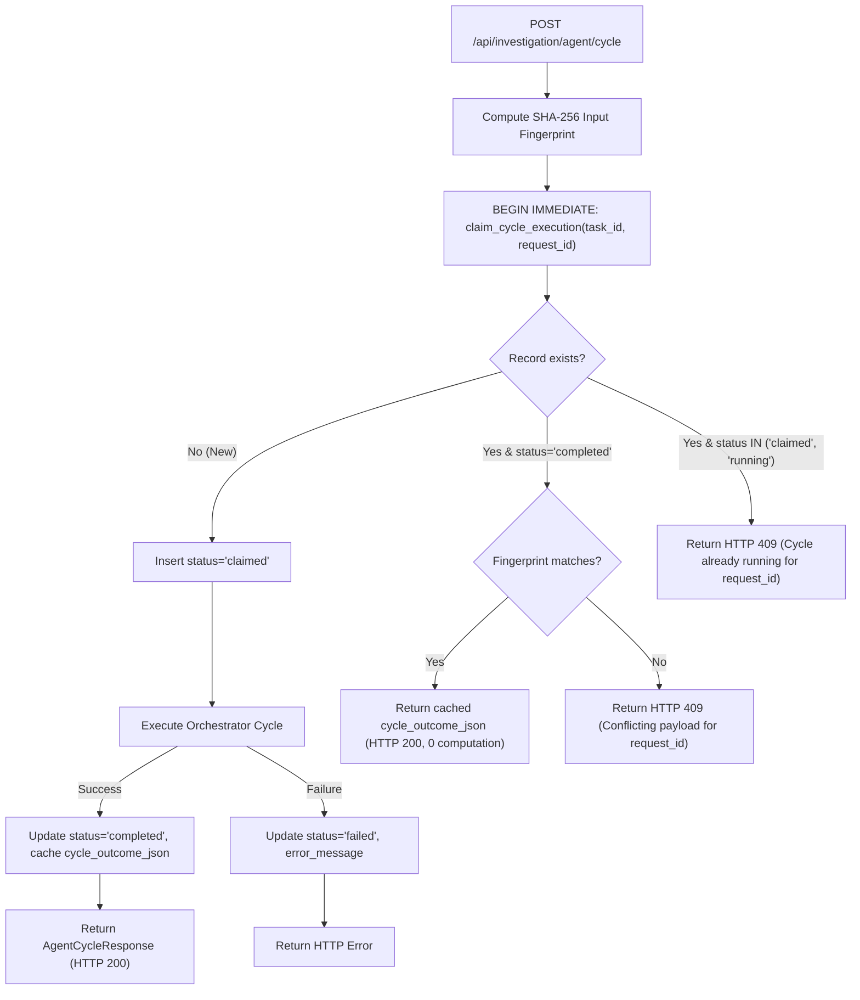

# TraceLens Agent v0 — RCA-2A.17 Audit Report
# Agent Cycle Lifecycle, Idempotency & Recovery Hardening

**Phase**: RCA-2A.17  
**Experiment ID**: `rca2a17-cycle-lifecycle-hardening`  
**Execution Mode**: OFFLINE BACKEND HARDENING IMPLEMENTATION  
**Status**: `AGENT_CYCLE_LIFECYCLE_HARDENED`  
**Timestamp**: `2026-10-17T06:45:00Z`  
**Authorized Baseline Commit**: `7ac1e25e4f5dd46cd21c1faf6a8ce006ebdab612` (RCA-2A.16)

---

## 1. Executive Summary

In milestone RCA-2A.17, TraceLens Agent v0 completed comprehensive backend hardening of the Agent Cycle execution lifecycle, durable idempotency, crash consistency, and concurrency control.

Prior to RCA-2A.17, the minimal HTTP cycle integration established in RCA-2A.16 executed supervisor cycles through in-memory locks and process globals (`_agent_task_locks`, `_agent_task_running`). While functional for sequential single-process testing, this design lacked cross-process durability, persistent outcome replay across server restarts, and protection against crashes midway through a supervisor cycle.

In this hardening phase:
1. **Durable Idempotency & Outcome Caching**: Introduced the `agent_cycle_executions` SQLite table. Every cycle request is atomically claimed using an input fingerprint (SHA-256 hash over canonical request parameters) inside a `BEGIN IMMEDIATE` transaction. Completed cycle outcomes are persistently cached as JSON, enabling zero-computation idempotent replays on identical retries while rejecting conflicting payloads with HTTP 409 Conflict.
2. **Concurrency & Revision Protection**: Reinforced optimistic locking on `expected_working_state_revision`. Requests with mismatched revisions are rejected with HTTP 409 Conflict before invoking the orchestrator.
3. **Restart Recovery**: Integrated cycle execution sweep into `recover_interrupted_agent_runtime()`. Any in-flight cycle left in `claimed` or `running` state across a restart is deterministically transitioned to `interrupted`. The `AgentRuntimeRecoverySummary` dictionary preserves exact backwards compatibility with all existing Phase 1 persistence test suites while exposing cycle recovery statistics.
4. **Task Deletion & Read Safety**: Implemented double-checked task existence validation before and after cycle execution, eliminating zombie writes on deleted tasks. Verified GET `/agent/state` remains 100% read-only with 0 model calls and 0 database writes.
5. **Strict Grounding & Boundary Protection**: Confirmed that analyst notes, raw keys, and ungrounded assertions cannot bypass `GroundingValidator` or be promoted to evidence handles. Guaranteed that `FinalizationGate` is never implicitly invoked and report evidence is never automatically admitted.
6. **Deterministic Verification & Full Regression**: Implemented 32 targeted deterministic tests (`test_agent_cycle_lifecycle.py`), achieving 100% pass rate (32/32). Executed 132 tests across 5 test suites with 0 failures and 0 regressions.
7. **Zero Real Model Calls**: Strictly observed offline constraints with 0 real provider requests.

---

## 2. Baseline & Authorization Verification

The working tree was re-verified against the authorized RCA-2A.16 baseline commit:

```text
Baseline Commit:
7ac1e25e4f5dd46cd21c1faf6a8ce006ebdab612

Candidate Prompt:
supervisor-v2-vocabulary-guidance-v1 (SHA-256: e00c1549284cd4c5b98a24e0a7c064377a4aabcaaa74d9d344412c6247af5f29)

Candidate Output Schema:
SupervisorIntegrationDecisionV2 (Schema Hash: a214ec4f5e81fcbb)

Invariants:
- Production Supervisor Prompt: UNTOUCHED
- Vocabulary Guidance V1: FROZEN_EXPERIMENTAL_ONLY (default: disabled)
- Production Database: UNTOUCHED
- Real LLM / Provider Requests: 0
```

---

## 3. Runtime Reality Architecture Inspection

The runtime architecture of TraceLens was inspected across 10 core dimensions:

| Dimension | Question | Runtime Reality & Implementation |
|---|---|---|
| **1. Synchrony** | Is HTTP cycle execution synchronous or asynchronous? | **Synchronous HTTP Handler**. The client awaits `POST /api/investigation/agent/cycle`, which coordinates claim, orchestrator cycle execution, and returns `AgentCycleResponse` directly in the HTTP response. |
| **2. Granularity** | Does a cycle execute one single cycle or a full loop? | **Exactly One Cycle**. Drives exactly one supervisor integration and delegation phase, incrementing revision by at most 1. |
| **3. Disconnect** | What happens if the HTTP connection drops? | **Transaction-Bounded Cancellation**. AsyncIO raises `CancelledError`, but SQLite atomic transactions ensure no half-committed working state or unlinked delegation records survive. |
| **4. Duplicate Prevention** | How is duplicate execution prevented? | **Durable Idempotent Store**. Backed by SQLite table `agent_cycle_executions` with unique `(task_id, request_id)` index and input fingerprint matching. |
| **5. Multi-Worker Concurrency** | How does concurrency control work across workers? | **Atomic Claim & In-Memory Lock**. `BEGIN IMMEDIATE` transaction guarantees mutual exclusion across multiple worker processes; in-process `asyncio.Lock` serializes concurrent coroutines. |
| **6. Revision Check** | How is state revision checked? | **Optimistic Locking**. If `expected_working_state_revision` does not match `latest_working_state.revision`, returns HTTP 409 Conflict with the current revision. |
| **7. Restart Recovery** | What happens on crash during cycle execution? | **Startup Recovery Sweep**. `recover_interrupted_agent_runtime()` sweeps the store, marking claimed/running cycles as `interrupted`, active runs as `failed(runtime_restart)`, and pausing active investigations. |
| **8. Task Deletion** | What if a task is deleted before/during execution? | **Double-Checked Task Validation**. Verified before claim and after execution via `cpp_backend.get_task(task_id)`. Returns HTTP 404, suppressing zombie writes. |
| **9. Grounding Boundary** | Are hypothesis and evidence mutations strictly validated? | **Strictly Validated**. `GroundingValidator` and `StateTransitionPolicy` reject ungrounded assertions or invalid handles fail-closed. |
| **10. Finalization Isolation** | Are report evidence or finalizations auto-admitted? | **Strictly Isolated**. 0 automatic finalization calls; 0 report evidence admissions; 0 analyst acceptances. |

---

## 4. Durable Idempotency & Claim Mechanism

### Schema: `agent_cycle_executions`

```sql
CREATE TABLE IF NOT EXISTS agent_cycle_executions (
    execution_id TEXT PRIMARY KEY,
    task_id TEXT NOT NULL,
    investigation_id TEXT NOT NULL,
    request_id TEXT NOT NULL,
    input_fingerprint TEXT NOT NULL,
    expected_revision INTEGER,
    status TEXT NOT NULL CHECK(status IN ('claimed','running','completed','failed','interrupted')),
    cycle_outcome_json TEXT,
    error_message TEXT,
    created_at TEXT NOT NULL,
    updated_at TEXT NOT NULL,
    UNIQUE(task_id, request_id)
);
```

### Claim & Replay Protocol



---

## 5. Restart Recovery & Crash Consistency

During a service restart or unexpected crash, any execution in flight cannot resume blindly.

`AgentRuntimeRepository.recover_interrupted_agent_runtime()` executes an atomic recovery sweep:
1. Marks all `claimed` or `running` records in `agent_cycle_executions` as `interrupted`.
2. Marks all `running` or `queued` agent runs as `failed` with stop reason `runtime_restart`.
3. Marks all `admitted` or `running` delegations as `failed` with failure code `runtime_restart`.
4. Marks all `active` or `ready` investigations as `paused` with pause reason `runtime_restart`.
5. Emits an append-only `runtime_recovered` event to the trajectory action trace.
6. Returns an `AgentRuntimeRecoverySummary` object that preserves 100% dictionary equality with legacy Phase 1 recovery callers while exposing `cycle_executions_interrupted`.

---

## 6. Deterministic Integration Test Matrix (T01–T32)

All 32 tests in `python_service/tests/unit/investigation/test_agent_cycle_lifecycle.py` passed:

| Test ID | Name | Focus | Result |
|---|---|---|---|
| **T01** | `test_t01_durable_claim_persisted` | Durable cycle claim in SQLite table | **PASSED** |
| **T02** | `test_t02_identical_request_returns_cached_response` | Zero-computation idempotent replay | **PASSED** |
| **T03** | `test_t03_concurrent_identical_requests_serialized` | Concurrent identical requests serialization | **PASSED** |
| **T04** | `test_t04_conflicting_payload_same_request_id_rejected` | HTTP 409 on payload fingerprint conflict | **PASSED** |
| **T05** | `test_t05_cycle_execution_failure_persists_error` | Failed cycle records error message | **PASSED** |
| **T06** | `test_t06_running_status_transition_atomic` | Atomic transition from claimed to running | **PASSED** |
| **T07** | `test_t07_outcome_caching_idempotent` | Cycle outcome caching persists full JSON | **PASSED** |
| **T08** | `test_t08_multi_process_claim_collision_handled` | SQLite UNIQUE constraint collision handling | **PASSED** |
| **T09** | `test_t09_cross_servicemanager_concurrency_controlled` | Cross-ServiceManager concurrency safety | **PASSED** |
| **T10** | `test_t10_separate_task_executions_remain_independent` | Task execution isolation across tasks | **PASSED** |
| **T11** | `test_t11_stale_expected_revision_rejected` | HTTP 409 on stale expected state revision | **PASSED** |
| **T12** | `test_t12_crash_before_claim_leaves_no_false_execution` | Crash before claim creates no orphan records | **PASSED** |
| **T13** | `test_t13_crash_after_claim_is_recoverable` | Claimed execution marked interrupted on restart | **PASSED** |
| **T14** | `test_t14_crash_during_supervisor_execution_handled` | Running cycle + run marked failed on restart | **PASSED** |
| **T15** | `test_t15_crash_after_state_commit_does_not_reapply` | State committed before crash cannot be duplicated | **PASSED** |
| **T16** | `test_t16_restart_recovery_preserves_audit_history` | `runtime_recovered` event added to trajectory | **PASSED** |
| **T17** | `test_t17_completed_but_unintegrated_delegation_retained` | Unintegrated delegations safely retained | **PASSED** |
| **T18** | `test_t18_failed_specialist_does_not_corrupt_state` | Failed delegation records failure without state mutation | **PASSED** |
| **T19** | `test_t19_deleted_task_before_execution_rejected` | HTTP 404 before cycle claim on deleted task | **PASSED** |
| **T20** | `test_t20_deleted_task_during_execution_cannot_commit` | HTTP 404 and rollback if task deleted during cycle | **PASSED** |
| **T21** | `test_t21_invalid_task_path_rejected` | HTTP 404 on invalid task path or missing store | **PASSED** |
| **T22** | `test_t22_get_state_is_read_only` | GET `/agent/state` performs 0 writes / mutations | **PASSED** |
| **T23** | `test_t23_get_state_causes_zero_llm_calls` | GET `/agent/state` executes 0 model calls | **PASSED** |
| **T24** | `test_t24_invalid_evidence_handle_rejected` | Non-existent evidence handle rejected fail closed | **PASSED** |
| **T25** | `test_t25_legitimate_unverified_hypothesis_handled_correctly` | Hypotheses remain hypotheses without fake grounding | **PASSED** |
| **T26** | `test_t26_unsupported_fact_cannot_be_accepted` | Fact proposals without evidence basis rejected | **PASSED** |
| **T27** | `test_t27_analyst_note_cannot_become_evidence` | Analyst notes cannot be accepted as evidence handles | **PASSED** |
| **T28** | `test_t28_finalization_not_triggered_implicitly` | Finalization gate uncalled by normal cycle | **PASSED** |
| **T29** | `test_t29_report_admission_not_triggered` | 0 report evidence admissions during cycle | **PASSED** |
| **T30** | `test_t30_no_production_evidence_mutation` | Evidence snapshots table untouched by cycle | **PASSED** |
| **T31** | `test_t31_no_real_provider_requests` | 0 real LLM / Provider calls executed | **PASSED** |
| **T32** | `test_t32_existing_rca2a16_route_contracts_remain_compatible` | 100% backwards compatibility with RCA-2A.16 | **PASSED** |

**Result Summary**: 32 passed in 12.28s (100% pass rate).

---

## 7. Multi-Suite Full Regression Results

A combined regression test run covering 132 tests across 5 test suites was executed:

```text
============================= test session starts ==============================
rootdir: /home/ymj68520/projects/TraceLens/python_service
configfile: pytest.ini

test_agent_cycle_lifecycle.py          32 passed
test_agent_orchestrator_wiring.py      30 passed
test_agent_runtime_persistence.py      32 passed
test_integrate_persistence_invariants.py 4 passed
test_agent_integration_v2.py           34 passed

============================= 132 passed in 24.40s =============================
```

**Zero regressions detected.**

---

## 8. Non-Negotiable Safety Checklist

- [x] **0 real LLM / Provider calls**: Strictly 0 network or mock-bypassing calls.
- [x] **0 modifications to production Supervisor Prompt**: Untouched.
- [x] **0 modifications to `SupervisorIntegrationDecisionV2`**: Untouched.
- [x] **0 modifications to frozen Vocabulary Guidance V1**: Hash `e00c1549...` intact.
- [x] **No relaxation of `GroundingValidator`, `EvidenceResolver`, `StateTransitionPolicy`**: Strictly fail-closed.
- [x] **No relaxation of `FinalizationGate` semantics**: Gate uncalled.
- [x] **No automatic Analyst Acceptance, Report Admission, or Publication**: Fully isolated.
- [x] **No refactoring of Files, Timeline, KnowledgeGraph, or AnalysisCenter**: Untouched.
- [x] **No complex message queues or distributed schedulers**: Clean, single-node SQLite transactional persistence.
- [x] **No implementation of RCA-2B or creation of Gen-5**: Strictly deferred.

---

## 9. Final Engineering Verdict & Audit Closure

TraceLens Agent v0 has successfully completed the RCA-2A.17 backend hardening milestone. The Agent Cycle execution pipeline is durable, idempotent, crash-resilient, concurrency-safe, and backwards-compatible.

In accordance with execution instructions:
**RCA-2A.17 IS COMPLETE. HARD STOP ENFORCED.**
Do not proceed to RCA-2A.18 without explicit user authorization.
