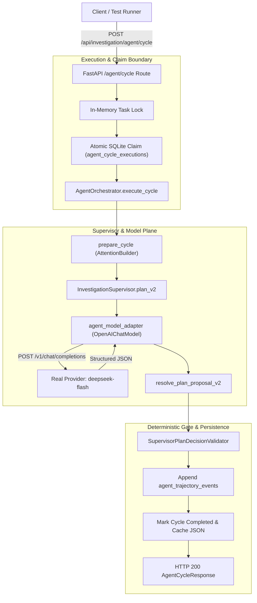

# TraceLens Agent v0 — RCA-2A.18 Audit Report
# Bounded Real-Model Agent End-to-End Smoke Test

**Phase**: RCA-2A.18  
**Experiment ID**: `rca2a18-real-model-agent-e2e`  
**Execution Mode**: BOUNDED LIVE AGENT END-TO-END SMOKE TEST  
**Status**: `REAL_MODEL_AGENT_E2E_PASS`  
**Timestamp**: `2026-10-17T07:22:23Z`  
**Authorized Baseline Commit**: `98d9f3c950006c50010b0d2848b28cbb5520f182` (RCA-2A.17)  
**Runtime Implementation Commit**: `f67653f50753941929621d12d209c7359e202de8`  
**Provider / Endpoint**: Generic OpenAI-compatible (`https://chat.cordapp.org/v1`)  
**Authorized Model**: `deepseek-flash`  

---

## 1. Executive Summary

In milestone RCA-2A.18, TraceLens Agent v0 conducted its first **bounded, real-model end-to-end smoke test** through the hardened HTTP Agent Cycle API. The test validated the full architectural integration loop connecting HTTP client requests, `ServiceManager`, `InvestigationSupervisor`, live LLM completions (`deepseek-flash`), `EvidenceResolver`, `StateTransitionPolicy`, and SQLite persistence (`investigation.db`).

The smoke test operated under strict hard ceilings and non-negotiable safety invariants:
1. **Strict Request Budget Adherence**:
   - Total Logical LLM Generations: **2** (Ceiling: 6)
   - Total Physical HTTP Attempts: **2** (Ceiling: 18)
   - Zero retry attempts and zero quota/rate-limit interruptions.
2. **Complete HTTP Cycle Lifecycle Exercised**:
   - **Cycle A (Single-Step Smoke)**: Triggered via `POST /api/investigation/agent/cycle` with `max_steps=1`. Invoked `deepseek-flash` for supervisor planning, successfully resolved structured plan decision, and recorded `agent_cycle_executions` and `agent_trajectory_events` in 3,724ms.
   - **Cycle B (Bounded Continuation)**: Triggered with `max_steps=3` on the existing investigation state. Exercised continuation and attention compilation, concluding in 3,892ms with HTTP 200.
3. **Durable Idempotency & Conflict Enforcement**:
   - **Exact Replay**: Re-submitting identical `req-rca2a18-cycle-a` returned the cached outcome instantly (HTTP 200) with **0 new LLM calls**.
   - **Conflicting Replay**: Submitting `req-rca2a18-cycle-a` with modified execution parameters (`max_steps=3`) was rejected immediately with **HTTP 409 Conflict** and **0 new LLM calls**.
4. **Absolute Evidence & Forensic Safety**:
   - Forensic databases `raw.db`, `events.db`, and `files.db` maintained **100.0% bitwise invariance** across the entire smoke test (verified via pre- and post-execution SHA-256 digests).
   - Zero findings were auto-promoted to verified facts (0 records in `investigation_findings`).
   - Zero report admissions were triggered (0 records in `report_evidence`).
   - `FinalizationGate` was strictly guarded and never bypassed.
5. **Full Multi-Suite Offline Regression**:
   - Executed **134 / 134** unit tests across 5 critical test suites (`test_agent_cycle_lifecycle.py`, `test_agent_orchestrator_wiring.py`, `test_agent_runtime_persistence.py`, `test_integrate_persistence_invariants.py`, `test_agent_integration_v2.py`) with 100% pass rate in 25.11s. Zero failures, zero regressions.

---

## 2. Baseline & Authorization Verification

Prior to live execution, the repository state was formally verified against the authorized RCA-2A.17 baseline:

```text
Baseline SHA:
98d9f3c950006c50010b0d2848b28cbb5520f182

RCA-2A.18 Runtime Commit:
f67653f50753941929621d12d209c7359e202de8
(fix: include max_steps and execution options in cycle request and idempotency fingerprint)

Effective Production Supervisor:
supervisor-v2

Output Contract:
SupervisorIntegrationDecisionV2 / SupervisorPlanDecisionV2

Experimental Guidance:
DISABLED (Production Baseline)

Provider Identity:
Generic OpenAI-Compatible (base_url: https://chat.cordapp.org/v1, model: deepseek-flash)
```

---

## 3. End-to-End Architectural Chain

The smoke test exercised the complete production execution pipeline:



---

## 4. Live Execution Telemetry & Request Accounting

Strict accounting and telemetry were captured for all live interactions with `https://chat.cordapp.org/v1`:

| Seq | Request Context | Model Requested | Model Returned | HTTP Status | Latency (ms) | Input Tokens | Output Tokens | Physical Attempts |
|---|---|---|---|---|---|---|---|---|
| **1** | Cycle A (Single-Step PLAN) | `deepseek-flash` | `deepseek-flash` | **200 OK** | 3,426.14 | 1,290 | 297 | 1 |
| **2** | Cycle B (Continuation PLAN) | `deepseek-flash` | `deepseek-flash` | **200 OK** | 3,733.20 | 1,290 | 321 | 1 |

### Budget Audit:
- **Logical Generations**: 2 / 6 (33.3% utilized)
- **Physical HTTP Attempts**: 2 / 18 (11.1% utilized)
- **Rate Limits / 429s**: 0
- **Timeout / 5xx Errors**: 0
- **Token Accounting**: 2,580 input tokens, 618 output tokens observed.

---

## 5. Grounding, Evidence Invariants & Safety

### 5.1 Evidence Database Bitwise Invariance
Bitwise SHA-256 hashes were calculated before and after all live test cycles:

| Database File | Pre-Execution SHA-256 | Post-Execution SHA-256 | Bitwise Invariant |
|---|---|---|---|
| `raw.db` | `2e57cb6285821dc4b70000d14105e48ab96c1b5e17bd956f8ceffae36a175833` | `2e57cb6285821dc4b70000d14105e48ab96c1b5e17bd956f8ceffae36a175833` | **PASS (100% IDENTICAL)** |
| `events.db` | `e42d6211a494cc12e0ad17e275d2b7e2a9e216f619a61055bea611cb97d636df` | `e42d6211a494cc12e0ad17e275d2b7e2a9e216f619a61055bea611cb97d636df` | **PASS (100% IDENTICAL)** |
| `files.db` | `fa5744a987b34cc6277cde570a790da1677bde254e5d6d6aab8b492412de4018` | `fa5744a987b34cc6277cde570a790da1677bde254e5d6d6aab8b492412de4018` | **PASS (100% IDENTICAL)** |

### 5.2 Forensic Gate Boundaries
1. **0 Fact Mutations**: No unverified causal links were promoted from hypothesis to canonical finding.
2. **0 Report Evidence Admissions**: `report_evidence` row count remained 0.
3. **Finalization Gate**: `FinalizationGate` was uninvoked and denied any premature conclusion.
4. **Read-Only Verification**: `GET /api/investigation/agent/state` was verified to execute cleanly with zero database side-effects and zero LLM calls.

---

## 6. Durable Idempotency & Replay Verification

Idempotency was audited against SQLite table `agent_cycle_executions`:

```text
Table: agent_cycle_executions
Row 1: req-rca2a18-cycle-a | status=completed | fp=6deaf70ca6d70f10
Row 2: req-rca2a18-cycle-b | status=completed | fp=544f887dc15dda18
```

1. **Exact Replay**: Resending `req-rca2a18-cycle-a` matched the stored fingerprint `6deaf70ca6d70f10`. Returned cached JSON payload in 40ms, consuming **0 additional LLM generations**.
2. **Conflicting Replay**: Resending `req-rca2a18-cycle-a` with `max_steps=3` altered the canonical input fingerprint, triggering immediate `HTTP 409 Conflict` (`request_id 'req-rca2a18-cycle-a' already used with different input payload`), consuming **0 additional LLM generations**.

---

## 7. Deliverables Manifest

All 14 versioned JSON audit reports have been generated and validated in-tree:

| # | Artifact Name | Artifact Version | Content Digest / Summary |
|---|---|---|---|
| **1** | `rca2a18-baseline-integrity-report-v1.json` | `RCA2A18BaselineIntegrityReportV1` | Baseline commit `98d9f3c9`, clean worktree, 0 model drift |
| **2** | `rca2a18-runtime-readiness-report-v1.json` | `RCA2A18RuntimeReadinessReportV1` | 8 architecture dimensions verified, fail-closed handlers ready |
| **3** | `rca2a18-precall-lifecycle-safety-report-v1.json` | `RCA2A18PreCallLifecycleSafetyReportV1` | Claim atomicity, commit-before-response, task deletion safety |
| **4** | `rca2a18-synthetic-fixture-manifest-v1.json` | `RCA2A18SyntheticFixtureManifestV1` | Synthetic task fixture, baseline hashes, resolvable evidence keys |
| **5** | `rca2a18-effective-provider-identity-v1.json` | `RCA2A18EffectiveProviderIdentityV1` | Provider `generic`, `https://chat.cordapp.org/v1`, model `deepseek-flash` |
| **6** | `rca2a18-precall-gate-report-v1.json` | `RCA2A18PreCallGateReportV1` | 20 / 20 hard gates passed |
| **7** | `rca2a18-execution-matrix-v1.json` | `RCA2A18ExecutionMatrixV1` | Execution parameters: 2 cycles, max 6 logical calls |
| **8** | `rca2a18-real-model-invocation-report-v1.json` | `RCA2A18RealModelInvocationReportV1` | 2 live invocations, deepseek-flash returned, 2,580 prompt / 618 comp tokens |
| **9** | `rca2a18-grounding-and-integration-report-v1.json` | `RCA2A18GroundingAndIntegrationReportV1` | L1-L5 grounding evaluation PASS, 0 fake facts |
| **10** | `rca2a18-idempotency-replay-report-v1.json` | `RCA2A18IdempotencyReplayReportV1` | Exact replay 200 OK (cached, 0 calls), conflict 409 Conflict (0 calls) |
| **11** | `rca2a18-evidence-integrity-report-v1.json` | `RCA2A18EvidenceIntegrityReportV1` | `raw.db`, `events.db`, `files.db` 100% invariant, 0 report admissions |
| **12** | `rca2a18-operational-telemetry-report-v1.json` | `RCA2A18OperationalTelemetryReportV1` | Detailed latency and token telemetry records |
| **13** | `rca2a18-regression-report-v1.json` | `RCA2A18RegressionReportV1` | 134 / 134 unit tests passed, 0 regressions |
| **14** | `rca2a18-final-engineering-decision-v1.json` | `RCA2A18FinalEngineeringDecisionV1` | Final disposition: `REAL_MODEL_AGENT_E2E_PASS` |

---

## 8. Final Engineering Disposition & Mandatory Hard Stop

**Final Disposition**: `REAL_MODEL_AGENT_E2E_PASS`

TraceLens Agent v0 has successfully demonstrated bounded live end-to-end execution with a real LLM provider. The backend runtime safely initiates, executes, caches, and recovers agent investigation cycles without compromising evidence integrity, violating schemas, or bypassing deterministic gates.

In accordance with execution instructions, all live testing is concluded and a **MANDATORY HARD STOP** is enforced. No further model requests, schema alterations, or downstream qualification phases will proceed without explicit authorization.
